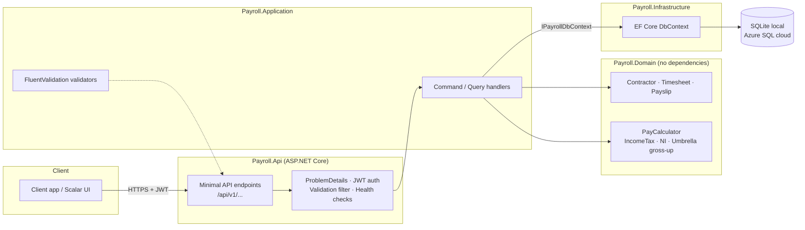
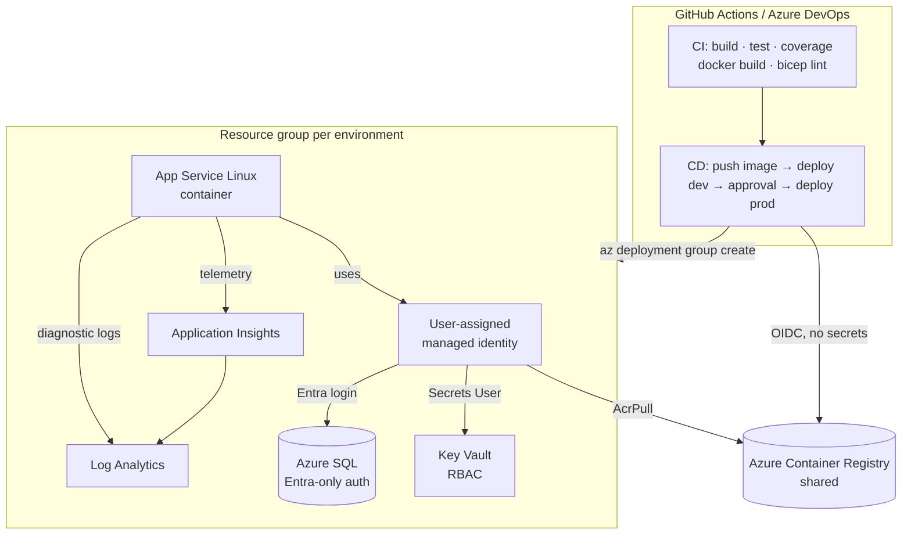

# Umbrella Payroll API — .NET 10 · Clean Architecture · Azure DevOps

[](https://github.com/SAhmad555/payroll-api-azure-devops/actions/workflows/ci.yml)


A production-style REST API for a **UK umbrella / contractor payroll** workflow:

> **timesheet → approval → assignment income → gross pay → PAYE income tax & National Insurance → payslip**

…plus everything needed to ship it to Azure: a multi-stage Dockerfile, Bicep infrastructure-as-code,
GitHub Actions with OIDC, and an equivalent Azure DevOps multi-stage YAML pipeline with a gated production stage.

> [!IMPORTANT]
> **Illustrative tax rules — not tax advice.** Rates and thresholds are hard-coded *sample* values that resemble
> recent rest-of-UK figures so the numbers look realistic. Many real-world rules are deliberately omitted
> (see [Simplifications](#simplifications)). Do not use this for real payroll.
> All people, companies and identifiers in this repository are **fictional**; NI numbers use HMRC's reserved
> example prefix `QQ` and e-mails use `example.com`.

---

## What this project demonstrates

| Area | Highlights |
|---|---|
| **Architecture** | Clean Architecture (Domain → Application → Infrastructure → Api), dependency rule enforced by project references, rich domain model with invariants and a timesheet state machine |
| **Application layer** | CQRS-lite: one command/query + handler per use case, resolved from DI (no mediator library), FluentValidation validators run in an endpoint filter |
| **Domain logic** | Tax-code parsing (`1257L`, `0T`, `K100`, `BR`, `D0`, `D1`, `NT`, emergency suffixes), banded income tax, K-code 50% overriding limit, Class 1 NI, umbrella employer-NI gross-up, penny-exact rounding rules |
| **API** | ASP.NET Core minimal APIs, URL-segment **API versioning** (`/api/v1`), **OpenAPI** document per version + Scalar UI, **RFC 9457 ProblemDetails** for every error (400/404/409/422/500), JSON enums as strings |
| **Security** | JWT bearer auth (Microsoft Entra ID ready) with `payroll.read` / `payroll.admin` policies; switchable off for local development; no secrets in config — Key Vault references + managed identity in Azure; Azure SQL with Entra-only auth |
| **Data** | EF Core 10 — SQLite locally/tests, **Azure SQL** in the cloud (provider chosen by config), explicit decimal precision, unique indexes, retry-on-failure |
| **Operability** | `/health`, `/health/live`, `/health/ready` (DB check), Application Insights via OpenTelemetry, App Service diagnostic logs → Log Analytics |
| **Testing** | 81 unit tests on pay calculations & domain rules (hand-worked expected values, edge cases) + 21 integration tests through the real HTTP pipeline with `WebApplicationFactory` (incl. auth on/off) |
| **DevOps** | Multi-stage Dockerfile (non-root), Bicep (App Service Linux container, Azure SQL, Key Vault, App Insights, user-assigned managed identity, RBAC), GitHub Actions CI with coverage, OIDC deploy with **build-once/promote** and a **required-reviewer production gate**, Azure DevOps pipeline (Build → Test → Deploy Dev → Deploy Prod with approvals), central package management, warnings-as-errors |

---

## Architecture



### Azure deployment



### Pay calculation pipeline

```
hours × rate (overtime × 1.5)                 = assignment income
  − umbrella margin                           = available funds
  − employer NI (gross-up: funds = G + (G − ST) × 15%)
                                              = GROSS PAY
  − PAYE income tax (non-cumulative, banded)
  − employee NI (8% main / 2% above UEL)
                                              = NET PAY
```

Worked example (covered by both a unit test and an end-to-end API test): 37.5 standard + 4 overtime hours at
£32.50/h, weekly, tax code `1257L` → income **£1,413.75**, gross **£1,226.21**, tax **£248.60**, NI **£63.18**, net **£914.43**.

---

## Solution layout

```
payroll-api-azure-devops/
├── src/
│   ├── Payroll.Domain/            # Entities, value objects, calculators — zero dependencies
│   ├── Payroll.Application/       # Use cases (commands/queries + handlers), validators, DTOs
│   ├── Payroll.Infrastructure/    # EF Core DbContext, configurations, seed data
│   └── Payroll.Api/               # Minimal API endpoints, auth, ProblemDetails, OpenAPI, health
├── tests/
│   ├── Payroll.Domain.Tests/          # xUnit — calculations & domain rules
│   └── Payroll.Api.IntegrationTests/  # xUnit + WebApplicationFactory + in-memory SQLite
├── infra/
│   ├── main.bicep                 # Per-environment resources
│   ├── main.dev.bicepparam / main.prod.bicepparam
│   ├── registry.bicep             # One-time shared ACR
│   ├── modules/acr-pull-role.bicep
│   └── scripts/grant-sql-access.sql
├── .github/workflows/             # ci.yml · deploy.yml · deploy-environment.yml (reusable)
├── .azure-pipelines/templates/    # deploy-bicep.yml (shared deploy steps)
├── azure-pipelines.yml            # Azure DevOps multi-stage pipeline
├── Dockerfile
├── Directory.Build.props          # net10.0, nullable, analyzers, warnings-as-errors
└── Directory.Packages.props       # Central package versions
```

---

## Endpoints

All business endpoints are versioned under `/api/v1`. Errors are `application/problem+json` with a machine-readable `code`.

| Method | Route | Policy | Description |
|---|---|---|---|
| `GET` | `/api/v1/contractors?page=&pageSize=&search=` | read | List contractors (paged, searchable) |
| `GET` | `/api/v1/contractors/{id}` | read | Get a contractor |
| `POST` | `/api/v1/contractors` | **admin** | Onboard a contractor (validated NI number & tax code) |
| `GET` | `/api/v1/contractors/{id}/payslips` | read | Contractor's payslips, newest first |
| `GET` | `/api/v1/timesheets?contractorId=&status=` | read | List timesheets |
| `GET` | `/api/v1/timesheets/{id}` | read | Get a timesheet with daily entries |
| `POST` | `/api/v1/timesheets` | read | Create a draft timesheet (overlap check, ≤ 24 h/day, ≤ 31-day period) |
| `POST` | `/api/v1/timesheets/{id}/submit` | read | Draft → Submitted |
| `POST` | `/api/v1/timesheets/{id}/approve` | **admin** | Submitted → Approved |
| `POST` | `/api/v1/timesheets/{id}/reject` | **admin** | Submitted → Rejected (reason required) |
| `POST` | `/api/v1/timesheets/{id}/payslip` | **admin** | Run payroll for an approved timesheet → payslip (once only) |
| `GET` | `/api/v1/payslips/{id}` | read | Payslip with full gross-to-net breakdown |
| `POST` | `/api/v1/payroll/calculate` | anonymous | Stateless "what-if" gross-to-net calculator |
| `GET` | `/health` · `/health/live` · `/health/ready` | anonymous | Health probes (ready includes the database) |
| `GET` | `/openapi/v1.json` · `/scalar/v1` | anonymous | OpenAPI document & interactive API reference |

**Policies:** `read` = any authenticated caller; `admin` = token carries the `Payroll.Admin` app role.
With `Auth:Enabled=false` (the Development default) every policy allows anonymous access.

### Status codes

| Code | When |
|---|---|
| `400` | Validation failed (FluentValidation errors keyed by field) |
| `401` / `403` | Missing/invalid token · missing `Payroll.Admin` role |
| `404` | Resource not found |
| `409` | Duplicate contractor, overlapping timesheet, payslip already issued |
| `422` | Business rule violated, e.g. `timesheet.not_submitted`, `timesheet.date_outside_period` |

---

## Run locally

**Prerequisites:** .NET SDK 10 or later. Nothing else — the API uses a local SQLite file and seeds fictional demo data.

```bash
dotnet build PayrollApi.slnx
dotnet test PayrollApi.slnx

dotnet run --project src/Payroll.Api --launch-profile http
# → http://localhost:5080/scalar/v1     interactive API reference
# → http://localhost:5080/health        health report
```

Try the flow against the seeded data (Ava's submitted week):

```bash
curl -X POST http://localhost:5080/api/v1/timesheets/4b1e9f3a-6c2d-4e7f-8a1b-3c5d7e9f0a11/approve
curl -X POST http://localhost:5080/api/v1/timesheets/4b1e9f3a-6c2d-4e7f-8a1b-3c5d7e9f0a11/payslip

curl -X POST http://localhost:5080/api/v1/payroll/calculate \
  -H "Content-Type: application/json" \
  -d '{"standardHours":37.5,"overtimeHours":4,"hourlyRate":32.50,"taxCode":"1257L","payFrequency":"Weekly"}'
```

### Docker

```bash
docker build -t payroll-api:local .
docker run --rm -p 8080:8080 -e ASPNETCORE_ENVIRONMENT=Development payroll-api:local
# → http://localhost:8080/health
```

### Configuration

| Key | Default | Purpose |
|---|---|---|
| `Database:Provider` | `Sqlite` | `Sqlite` or `SqlServer` |
| `ConnectionStrings:Payroll` | `Data Source=payroll.db` | In Azure: Azure SQL with `Authentication=Active Directory Managed Identity` |
| `Database:InitializeOnStartup` / `SeedSampleData` | `true` / `true` | Demo schema creation + fictional seed data |
| `Auth:Enabled` | `true` (`false` in Development) | Toggle JWT bearer auth |
| `Auth:Authority` / `Auth:Audience` | — | Entra ID tenant authority and API audience |
| `Payroll:WeeklyUmbrellaMargin` / `MonthlyUmbrellaMargin` | `18.00` / `78.00` | Sample umbrella margin per period |
| `APPLICATIONINSIGHTS_CONNECTION_STRING` | — | Enables Azure Monitor OpenTelemetry export when set |

---

## CI/CD

### GitHub Actions

| Workflow | Trigger | What it does |
|---|---|---|
| [`ci.yml`](.github/workflows/ci.yml) | PRs and pushes to `main` | Restore → build (warnings-as-errors) → unit + integration tests → Cobertura coverage → ReportGenerator summary in the job summary → artifacts. In parallel: Docker image build (no push) and `az bicep build` lint of all templates/params. |
| [`deploy.yml`](.github/workflows/deploy.yml) | Push to `main`, manual | **Build once**: image pushed to ACR tagged with the commit SHA. Then the reusable [`deploy-environment.yml`](.github/workflows/deploy-environment.yml) runs for **dev** and then **production** — `what-if` → `az deployment group create` (Bicep + image) → restart → smoke test on `/health/live`. |

* **No stored cloud secrets.** `azure/login@v2` exchanges a GitHub OIDC token for an Entra ID token
  (workload identity federation). Create federated credentials for `repo:<owner>/<repo>:ref:refs/heads/main`,
  `…:environment:dev` and `…:environment:production`.
* **Production approval.** The `production` GitHub environment has *required reviewers*, so the prod job pauses
  until someone approves. The image deployed to prod is byte-for-byte the one validated in dev.
* **Setup:** repository variables `AZURE_CLIENT_ID`, `AZURE_TENANT_ID`, `AZURE_SUBSCRIPTION_ID`, `ACR_NAME`;
  environment variable `AZURE_RESOURCE_GROUP` on each environment.

### Azure DevOps

[`azure-pipelines.yml`](azure-pipelines.yml) is the equivalent multi-stage pipeline (AZ-400 style):

```
Build ──► Test ──► Deploy Dev ──► Deploy Prod
                    │               └─ environment "payroll-prod" → Approvals & checks
                    └─ push image to ACR (Docker@2) → deployment job on "payroll-dev"
```

* **Build** — restore, build, publish the API artifact, `az bicep build` validation, publish `infra` artifact.
* **Test** — `DotNetCoreCLI@2 test` with test-result publishing and `PublishCodeCoverageResults@2` (Cobertura).
* **Deploy Dev / Prod** — `deployment` jobs targeting ADO *Environments*; shared steps live in
  [`.azure-pipelines/templates/deploy-bicep.yml`](.azure-pipelines/templates/deploy-bicep.yml) (what-if → deploy → restart → smoke test).
  Production is gated by an **Approvals** check configured on the `payroll-prod` environment.
* Uses an ARM service connection with **workload identity federation** and a Docker registry service connection.

### Infrastructure (Bicep)

[`infra/main.bicep`](infra/main.bicep) provisions, per environment:

* **App Service plan (Linux)** + **Web App for Containers** — HTTPS-only, TLS 1.2, FTPS disabled, health-check path `/health/ready`
* **User-assigned managed identity** — pulls from ACR (`AcrPull`), reads Key Vault (`Key Vault Secrets User`), logs in to Azure SQL
* **Azure SQL** server + database — **Entra-only authentication** (no SQL passwords anywhere)
* **Key Vault** (RBAC mode) — App Insights connection string surfaced to the app via a Key Vault reference
* **Application Insights** (workspace-based) + **Log Analytics** + App Service diagnostic settings

One-time bootstrap:

```bash
az group create -n rg-payroll-shared -l uksouth
az deployment group create -g rg-payroll-shared -f infra/registry.bicep -p registryName=<unique-acr-name>
az group create -n rg-payroll-dev  -l uksouth
az group create -n rg-payroll-prod -l uksouth
# after the first deployment, as a member of the SQL admin group:
sqlcmd -S <sqlServerFqdn> -d sqldb-payroll -G -i infra/scripts/grant-sql-access.sql -v IdentityName="id-payroll-dev"
```

Parameter files contain **placeholder** tenant/group ids — replace them with your own before deploying.

---

## Simplifications

This is a portfolio project; the following are intentionally out of scope and called out so nobody mistakes it for real payroll software:

* **Tax:** non-cumulative (week 1 / month 1) basis only; no Scottish/Welsh rates; no personal-allowance taper;
  tax-code allowance = number × 10; period bands rounded up to whole pounds; NI category A only; rates are sample values.
* **Umbrella model:** no employer pension, apprenticeship levy, holiday-pay accrual, expenses or student loans.
* **Persistence:** `EnsureCreated` instead of EF Core migrations (a migrations bundle run as a pipeline step is the production approach).
* **Networking:** Azure SQL allows Azure services through its firewall; production hardening would add VNet integration and private endpoints.

---

## Author

**Shahbaz Ahmad** ([@SAhmad555](https://github.com/SAhmad555)) — .NET / SQL Server engineer with 14 years of experience,
focused on Azure and DevOps (AZ-104 / AZ-400 track).

Portfolio: **https://sahmad555.github.io/Portfolio**

## License

[MIT](LICENSE) © 2026 Shahbaz Ahmad
